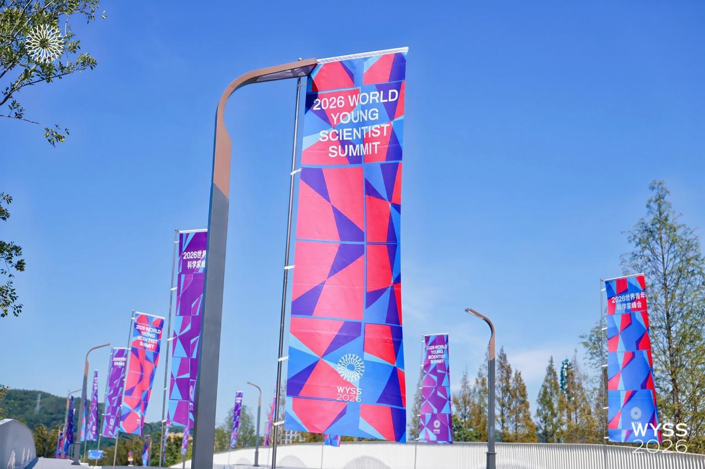

## A gathering of young scientists from around the world

I was honoured to participate in the 2026 World Young Scientist Summit (WYSS), held in Wenzhou, Zhejiang Province, China, as a member of the delegation of The World Academy of Sciences (TWAS), the Guest of Honour organisation for WYSS 2026. I am especially grateful to the Organization for Women in Science for the Developing World (OWSD) for nominating me for this valuable opportunity. 

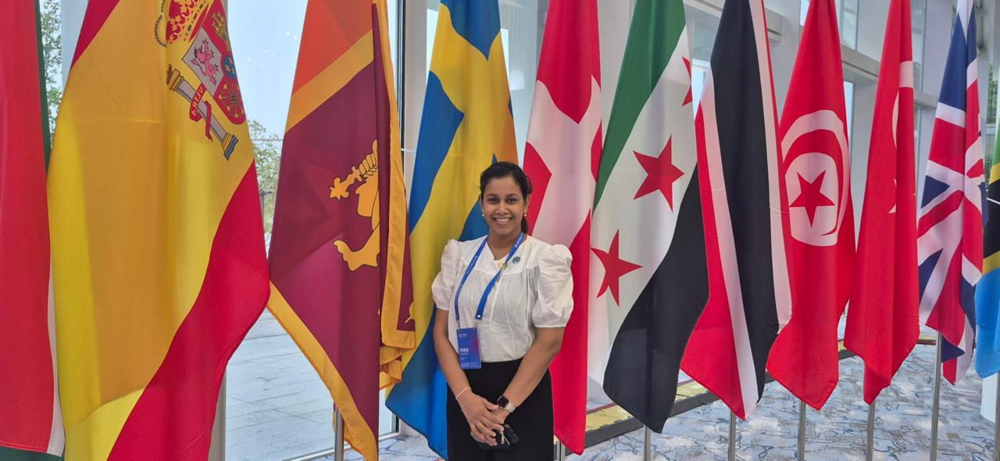{width=90% fig-align="center"}

Hosted by the China Association for Science and Technology (CAST), the Zhejiang Provincial People's Government and the World Association of Young Scientists (WAYS), the summit brought together nearly 800 scientists, educators and entrepreneurs from more than 60 countries and regions. Under the theme "Gathering Talents Worldwide to Create a Better Future," the summit focused on "Global Youth Action in the AI Era: Building a Sustainable Future." It provided a platform to exchange ideas, explore the role of artificial intelligence in different fields and discuss how international scientific collaboration can help address global challenges.

## Day 1: Connecting young scientists and exploring global challenges

The summit activities began on 23 October with the International Young Scientists' Roundtable. The programme included an introduction to WAYS and WYSS, a young scientists' sharing session and interactive discussions on global challenges and the potential of artificial intelligence to address them.

What I particularly enjoyed was the opportunity to hear different perspectives from young scientists working in diverse fields and countries. Although our research interests and backgrounds differed, we shared a common interest in using science and technology to make a positive contribution to society. The discussions highlighted both the opportunities AI creates and the challenges we need to consider as it becomes part of more areas of our lives.

### Rethinking scientific research in the age of AI

One of the most thought-provoking parts of the International Young Scientists' Roundtable was the discussion on how scientific research is changing in the age of artificial intelligence. Several important points were raised about the responsibilities of young scientists, the role of AI in research and the values that must remain at the heart of scientific progress.

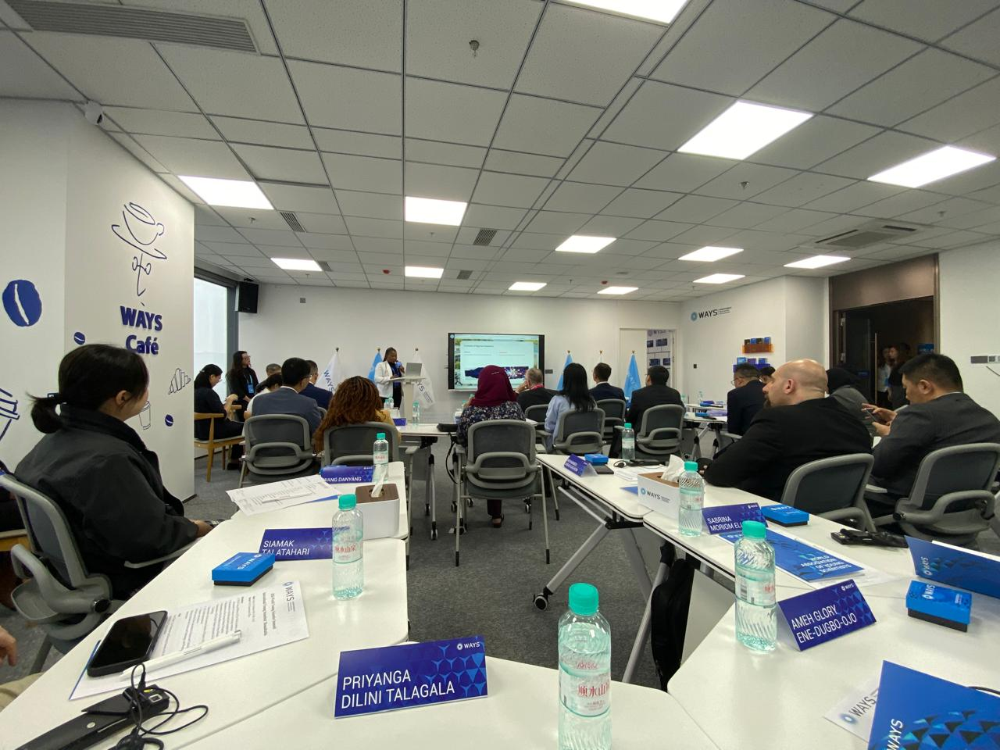{width=90% fig-align="center"} 

One point that particularly stood out to me was the growing tendency to focus on producing polished manuscripts rather than on the quality of the scientific work itself. A well-written paper is important, but it should never become more important than sound scientific results, reliable data and the proper validation of findings. These are the foundations of meaningful scientific progress. AI tools will continue to evolve, but the fundamental purpose of science remains unchanged: to explain and understand how the natural world works while building reliable, evidence-based knowledge.

<iframe height="578" width="325" src="https://www.tiktok.com/player/v1/7700210905736367393?embed_from=webapp_share&music_info=1&description=1&autoplay=1&muted=1" frameborder="0" allow="accelerometer; autoplay; clipboard-write; encrypted-media; fullscreen; gyroscope; picture-in-picture; web-share" allowfullscreen loading="lazy"></iframe>

The discussion also highlighted the importance of curiosity-driven research, scientific integrity and collaboration across disciplines and national borders. Scientific progress depends not simply on producing more publications, but on asking meaningful questions, carefully validating results and building knowledge that others can trust and build upon. In an increasingly connected world, collaboration across disciplines and countries is essential for addressing complex scientific challenges.

Another important point was the potential of AI to make science more accessible and inclusive. Language barriers and limited access to scientific resources can prevent researchers, particularly those in developing countries, from fully participating in global scientific activities. AI tools can help researchers improve their academic writing, translate scientific information into their own languages and access scientific knowledge more quickly. These opportunities are particularly important for developing countries, enabling their researchers to engage more actively in global scientific programmes, contribute their own knowledge and participate in scientific progress. By making knowledge more accessible and supporting communication across languages, AI has the potential to accelerate scientific progress worldwide.

However, the discussion also emphasised that AI should support scientific judgement, not replace the judgement of experts. Its use must be guided by research integrity and ethical responsibility. AI can be misused, for example, by generating fabricated references or misrepresenting scientific results. Such practices undermine the credibility of research and the trust placed in scientific publications. Researchers therefore have a responsibility to verify information, validate results, check references and ensure that their work accurately represents the evidence.

For me, one of the key messages from this discussion was that technological progress alone does not guarantee scientific progress. AI can make research faster and scientific communication easier, but the reliability of scientific records, research ethics and the integrity of researchers remain essential. As young scientists embrace the opportunities offered by AI, we must ensure that these tools strengthen scientific research rather than compromise the principles on which it is built.

### An evening of Chinese hospitality

The first day concluded with the WYSS Welcome Dinner at Awailou Resort Hotel. It was a wonderful introduction to Chinese food, culture and hospitality. The dinner featured a variety of traditional Chinese dishes and our hosts took the time to introduce us to Wenzhou, its strengths, facilities and areas of development.

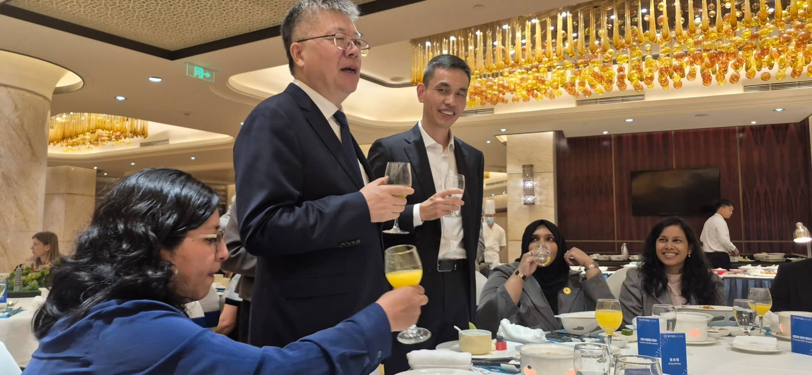{width=90% fig-align="center"}

At our table, we had the pleasure of meeting Zhang Benfeng, Vice Mayor of the Wenzhou Municipal People's Government and a former second-class inspector of the Zhejiang Provincial Association for Science and Technology. Their presence and the warm welcome extended by the hosts made the evening particularly memorable.

One thing that impressed me throughout the day was how carefully the organisers had considered communication. English translation headphones were provided during the sessions, while a dedicated interpreter assisted our table during the dinner, translating the hosts' introductions and conversations.

Watching people from different countries connect, share ideas and enjoy conversations despite speaking different languages was a special experience. It reminded me that language does not have to be a barrier when people are willing to connect and understand one another.

The first day set a wonderful tone for the summit. It was not only about science and technology. It was also about people, cultures, shared challenges and the possibilities that emerge when we come together.

## Day 2: Science without borders and the power of young minds

On 24 October, the second day of the World Young Scientist Summit 2026 featured the plenary sessions at the China Pavilion International Conference Center in Wenzhou Garden Expo Park, China.

Before the plenary sessions, I visited an exhibition showcasing several cutting-edge technologies and innovative developments. This was particularly valuable for me as the Faculty of Information Technology at the University of Moratuwa was preparing for FIT Expo 2026, scheduled for November. Seeing how new technologies and innovations were presented provided useful ideas and inspiration for our upcoming exhibition.

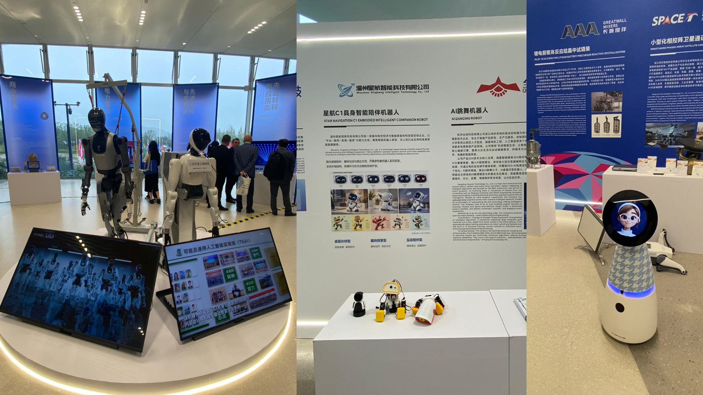{width=80% fig-align="center"}

  <a href="https://news.cgtn.com/news/2026-10-26/VHJhbnNjcmlwdDkzMDA4/index.html"
     target="_blank" rel="noopener">
    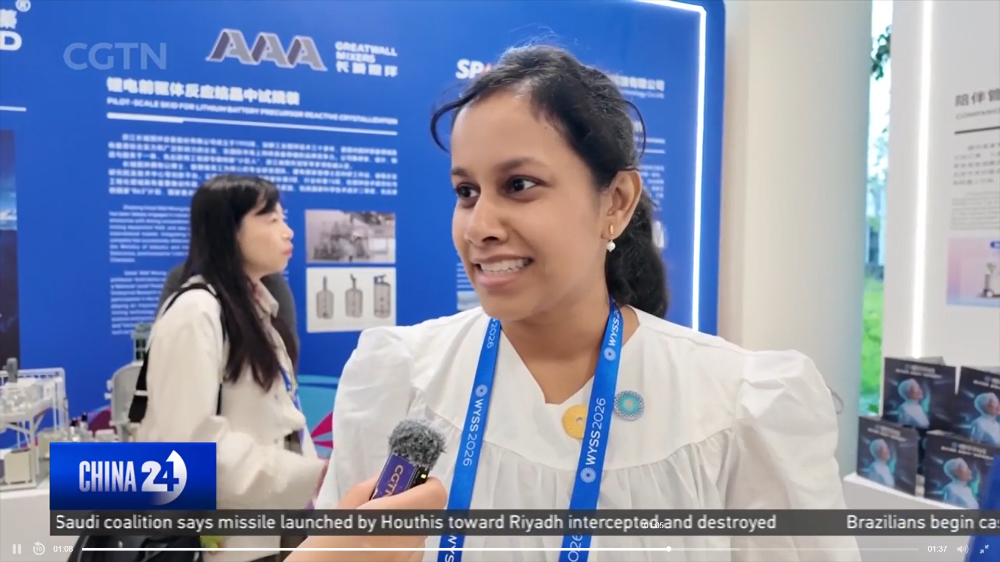
  </a>
  
<em>CGTN news coverage of the World Young Scientist Summit 2026. Click the image to watch or read the coverage.</em>

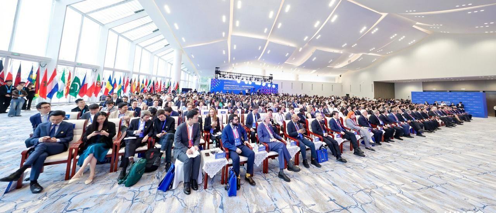{width=90% fig-align="center"}

Several important messages emerged from the WYSS 2026 plenary sessions. One that particularly resonated with me was that **"science is like water. It should flow across borders."** Scientific knowledge should be shared freely, allowing researchers from different countries and backgrounds to learn from one another and work together to address global challenges. We must also embrace AI across disciplines and explore its potential to advance science, education, industry and society.

Closely related to this idea of sharing knowledge was another key message: **"innovation is not a solo performance, but a shared pursuit involving all sectors of society."** Meaningful innovation requires collaboration among researchers, universities, industries, businesses and governments. Bringing these groups together helps transform scientific discoveries into practical solutions that benefit society.

Wenzhou's **“One Hub and Five Valleys”** innovation cluster, which includes the China Data Security Hub, offered an interesting example of this approach. The initiative brings together approximately 5,400 enterprises and more than 400,000 young people, highlighting the scale of the local innovation ecosystem and the importance of connecting talent, businesses and technology.

These examples reinforced the idea that scientific progress depends not only on individual discoveries but also on how effectively we share knowledge, collaborate across boundaries and create environments where ideas can grow into meaningful innovations. **Young people have an important role to play in this process.** Another key message from the plenary sessions was the need to empower the next generation of scientists and innovators and give them opportunities to contribute to a better future.

This brought me to another important topic: the role of education in the age of AI. One particularly meaningful message was: **“AI can be a powerful tool in the hands of a good teacher. Even where a good teacher is not readily available, AI can provide students with opportunities to learn and explore knowledge.”** This highlights the potential of AI to make education more accessible, particularly for students with limited access to educational resources. However, realising this potential also requires us to recognise the importance of the knowledge and education on which these technologies depend.

The achievements of modern technology, including AI, are built on generations of fundamental human knowledge. Today's AI algorithms draw on mathematics, statistics and computer science and their capabilities are the result of decades of scientific discovery, mathematical reasoning and continuous learning. **"AI itself grew out of mathematics and the fundamental sciences."** Therefore, as we explore new possibilities with AI, we must continue investing in education, fundamental research and the development of young scientific talent. These foundations will be essential for responsible innovation and sustainable progress.

### But why does a summit like this place such a strong emphasis on young scientists?

Looking back at the history of science, many groundbreaking contributions were made when scientists were still relatively young. Albert Einstein was 26 when he published several of his landmark papers in 1905, transforming our understanding of physics. Alan Turing developed the foundational ideas behind modern computation in his early twenties, helping lay the groundwork for artificial intelligence. John McCarthy was also a young researcher when he helped establish AI as a distinct field of study in the 1950s. 

These examples remind us that young people should not simply be viewed as the future of science. They are already contributing to scientific progress today. They bring curiosity, fresh perspectives and a willingness to question existing approaches. Providing them with opportunities, resources, mentorship and international connections can help turn their ideas into meaningful discoveries and innovations.

For me, this was one of the most valuable messages of the summit. **If we want to build a better future, we must invest in young people, strengthen education, support fundamental scientific research and create opportunities for talent to flourish across borders.** Innovation is not just about developing the next technology. It is about nurturing the people and knowledge that make such developments possible.

### Women scientists in the age of AI

In the afternoon, I attended the 2026 World Young Scientist Summit Women Scientists Forum, themed "Women's Scientific Power in the AI Era: Innovation Growth and Global Collaboration."

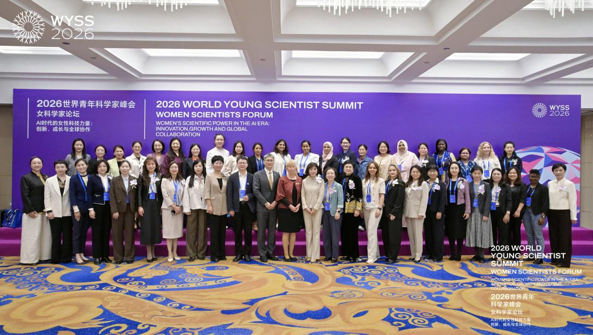{width=90% fig-align="center"}

Several women scientists shared their innovations and research across different application domains, followed by panel discussions on the role of women in science, technological innovation and international collaboration.

One message that particularly stayed with me was the importance of women's voices and representation in the AI era. As one speaker pointed out, instead of asking whether AI would take away our jobs, we should focus on embracing AI and learning how to use it effectively. Rather than viewing AI only as a threat, we need to understand its potential and actively participate in shaping its future.

In my view, one issue that deserves attention is how gaps in research data can affect women and the AI systems developed using that data. When women's experiences are underrepresented in research, their needs may be overlooked in the technologies and services built on that evidence.

These issues have implications for AI. Systems trained on incomplete or unrepresentative data risk reproducing existing biases and overlooking the needs of groups that are already underrepresented. Developing better AI therefore requires more than improving algorithms. We also need to consider whose data are included, whose experiences are represented and whose needs are being addressed.

For AI to benefit everyone, women need stronger representation not only in the data used to develop these systems but also among the researchers, developers, decision-makers and leaders shaping their future. Building inclusive AI begins with recognising whose experiences may be missing and taking steps to address those gaps.

## Day 3: AI and the future of scientific publishing

On the third day, I attended the "2026 World Young Scientist Summit: Young Scholars and Premier Journals - A Collaborative Growth Forum." The forum explored how artificial intelligence is changing scientific publishing, from the way authors write and reviewers evaluate manuscripts to the way editorial offices manage submissions and readers access scientific knowledge.

One of the key discussions focused on how AI is changing the behaviour and practices of authors, reviewers, editors and readers. Authors are increasingly using AI in writing, while reviewers and editors are exploring ways to use it to make the review process more efficient. AI tools can also help editorial offices automate administrative tasks, conduct checks for duplicate submissions and support readers who have limited time to engage with the growing volume of scientific literature.

An important challenge highlighted during the forum was the growing pressure on the scientific publishing system. According to an analysis presented at the event, the volume of paper submissions increased by 55% between January 2023 and December 2025, while published output increased by only 28% over the same period. This gap places an increasing burden on reviewers and editorial boards, whose time and expertise are essential for maintaining the quality of scientific publications.

AI may offer ways to accelerate the review process and reduce administrative workloads. However, it is equally important to identify the misuse of AI and potential research misconduct. AI-generated content can appear convincing without representing genuine, rigorous scientific work. Detecting such problems is not always straightforward, making the responsibilities of reviewers and editorial boards more important than ever.

A particularly memorable message came from Emmie Yang, Head of Publishing, APAC, at IOP Publishing. She emphasised a distinction that I found especially important: "AI is not misconduct. AI provides signals, not verdicts. AI can assist, but it cannot replace accountability."

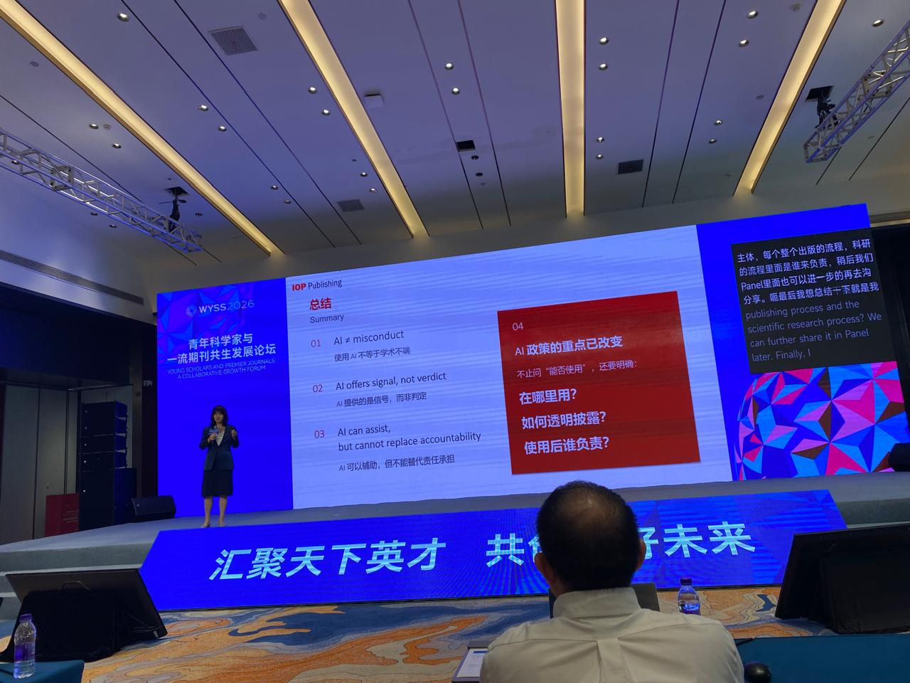{width=90% fig-align="center"}

This is a valuable principle for the future of scientific publishing. The use of AI should not automatically be treated as misconduct. Instead, concerns must be assessed carefully, with human judgement playing a central role. AI can help identify potential problems, but the final responsibility for evaluating evidence, ensuring research integrity and making editorial decisions must remain with people.

The discussion reinforced my view that the future of scientific publishing will depend not simply on how effectively we adopt AI, but on how responsibly we use it. We need efficient publishing processes that can keep pace with the growth of research while protecting scientific integrity, rigorous peer review and trust in the published scientific record.

### Exploring the history and culture of Wenzhou

In the afternoon, we went on a cultural tour of Wenzhou, visiting Shuomen Ancient Port and the World Wenzhounese Museum. It was wonderful to learn more about the history and global connections of the city that hosted the summit.

Our first stop was Shuomen Ancient Port, a historic port that played an important role in Wenzhou's maritime trade and its connections with the ancient Maritime Silk Road. Archaeological discoveries at the site have revealed remains of old docks, shipwrecks and ancient trade activities, reflecting Wenzhou's history as a centre of overseas commerce. It was fascinating to see how the city had built connections with other parts of the world through trade long before today's modern transport and communication systems.

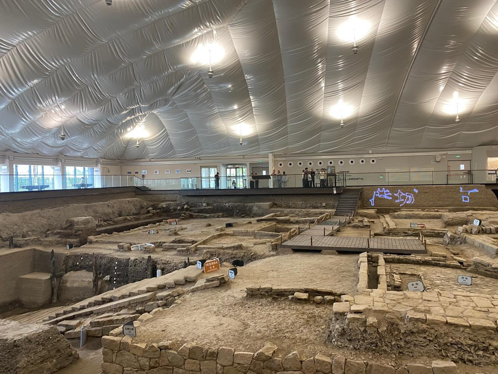{width=90% fig-align="center"}

We then visited the World Wenzhounese Museum, which tells the story of Wenzhou people who have travelled across the world and established communities in different countries. The museum highlights their migration journeys, entrepreneurial spirit, cultural identity and contributions to communities both at home and overseas.

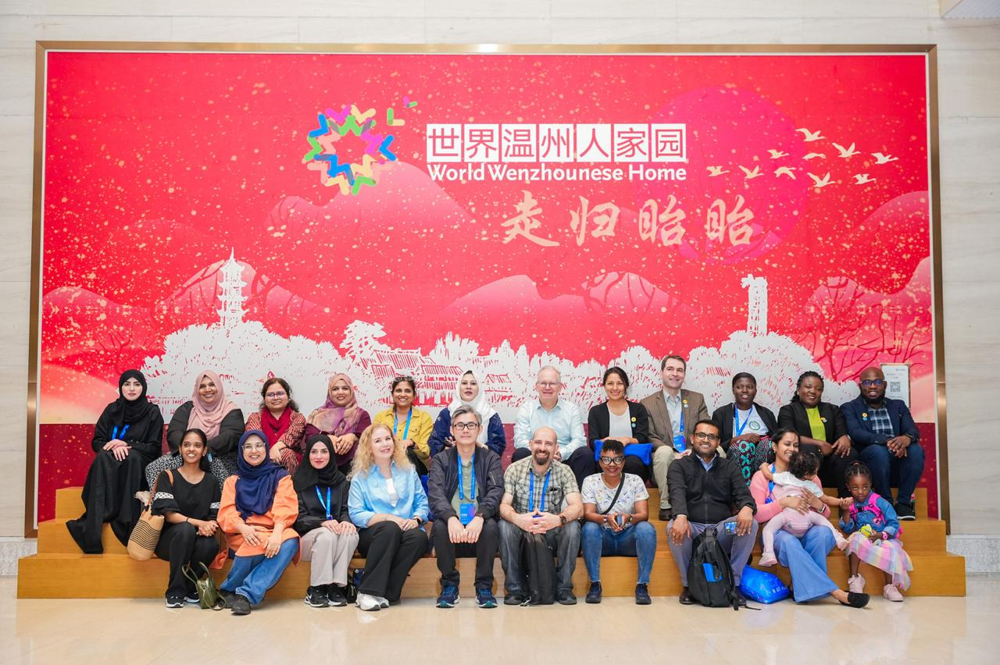{width=90% fig-align="center"}

What I found particularly interesting was the connection between these two visits. Shuomen Ancient Port represented Wenzhou's historic links with the world through maritime trade, while the museum showed how those global connections have continued through generations of migration and entrepreneurship.

The visits offered a valuable reminder that international connections are built not only through science and technology but also through people, culture, trade and shared experiences.

## Day 4: A little escape from the city

After three days filled with scientific discussions, new ideas and opportunities to connect with researchers from around the world, Day 4 offered a different experience. 

The view from our hotel showed another side of Wenzhou, with its impressive high-rise buildings and busy commercial landscape. It reflected the city's rapid development and urban character.

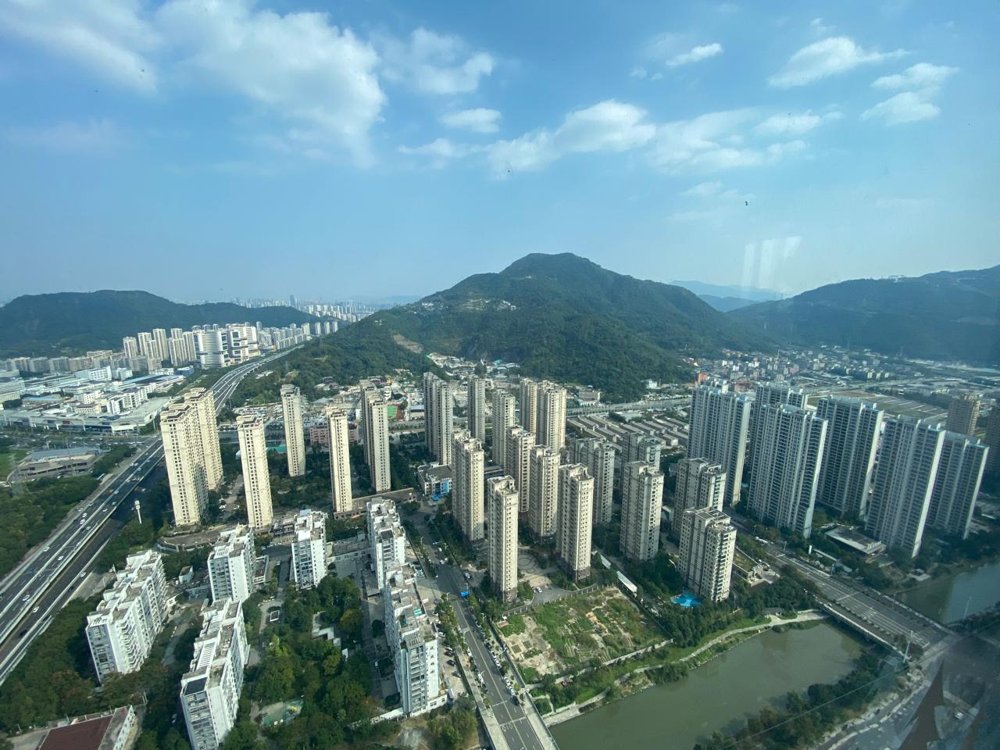{width=80% fig-align="center"}

However, our final day also gave us an opportunity to discover a very different side of the region as we travelled to Yongjia County to explore its beautiful countryside, traditional villages and cultural heritage. Andy, our tour guide, made the day even more enjoyable with his excellent guidance and friendly approach.

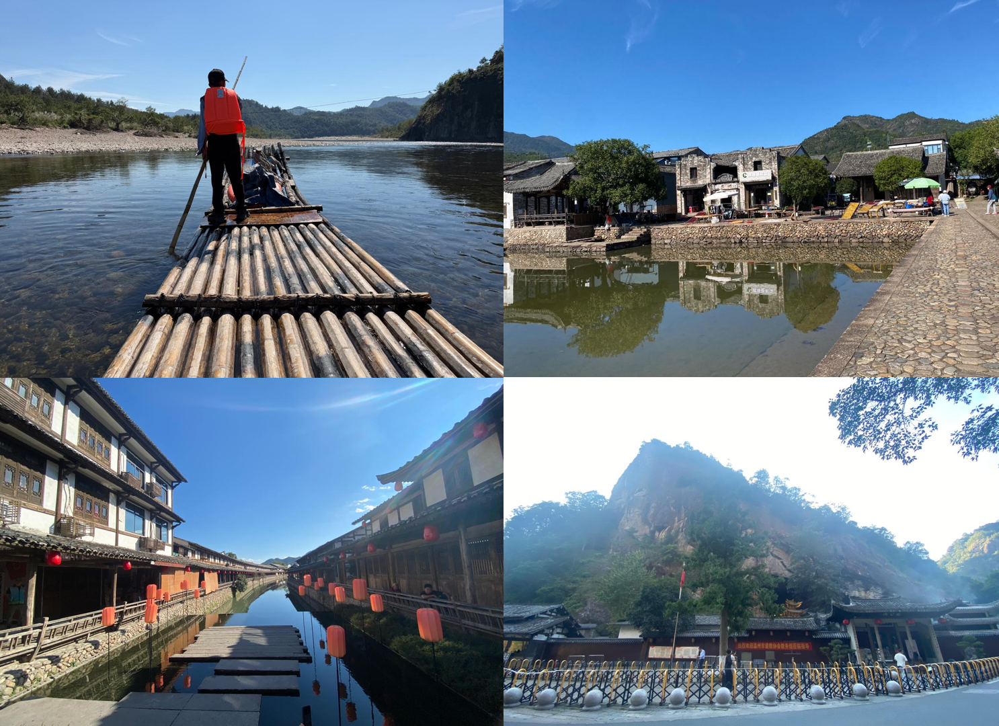{width=90% fig-align="center"}

#### Floating along the Nanxi river

Our first stop was the beautiful Nanxi River, where we enjoyed a peaceful bamboo raft ride surrounded by green mountains and traditional rural scenery. After several days of conference sessions, it was refreshing to slow down, enjoy the quiet surroundings and take in the natural beauty of the region.

#### Cangpo Ancient Village where farming meets learning

Next, we visited Cangpo Ancient Village, a historic settlement with a village layout dating back to the Song Dynasty. What fascinated me most was how the village's design reflects the importance of both education and agriculture in traditional Chinese culture. Its layout incorporates the Four Treasures of the Study0brush, inkstick, paper and inkstone.

The village's philosophy can be summed up in a beautiful idea: "studying brings honour, while farming brings fortune." It was interesting to see how these values were reflected in the design and history of the village.

#### Walking through history at Yantou Village

Our next stop was Yantou Village, home to Lishui Ancient Street. The long wooden gallery street, built during the Ming Dynasty, runs alongside a canal that was also part of the village's water-management system. Walking along this historic street offered a glimpse into how earlier generations designed their communities around both everyday life and the natural environment.

#### Taogong Cave

We ended our countryside tour at Taogong Cave, a striking natural cavern associated with Taoist traditions. Its impressive rock formations and peaceful surroundings made it a memorable final stop on our exploration of Yongjia.

This little escape from the city was more than a break from the conference. It gave me the opportunity to experience another side of Wenzhou—its landscapes, history, traditions and warm hospitality—and left me with memories that I will treasure long after the summit.

### Ending the day with wonderful hospitality

After a day of exploring, we returned for a fine-dining dinner at Tonglingshan Hall at the Hilton Wenzhou City Center. It was a lovely way to end the journey and spend time with the people who had made the entire experience so special.

## The people who made it special

I want to end by giving a very special shout-out to Zoe and Georgia, who did a fantastic job as the main coordinating team, as well as the student volunteers and local partners who contributed to making this experience so memorable.

Zoe and Georgia went above and beyond to look after every participant, from the visa application process before our arrival to our departure from China. What impressed me most was the individual attention they gave to everyone's needs and requests. They paid attention to even the smallest details and were always ready to help. Their support went far beyond coordinating the conference programme. They made sure we felt supported throughout the entire journey.

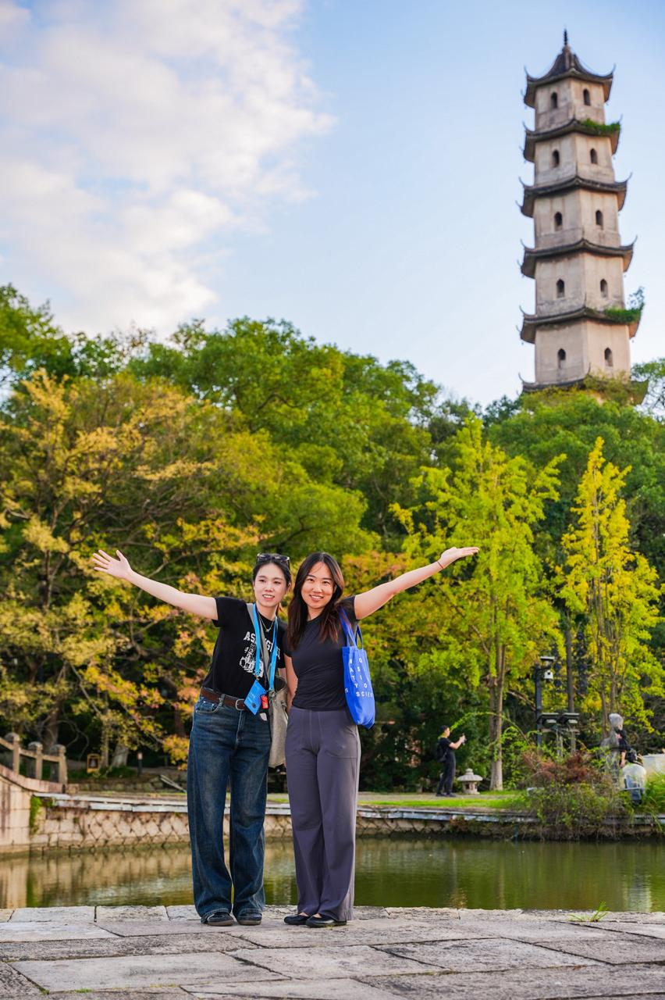{width=45% fig-align="center"}

They also carefully managed the programme so that we could attend sessions on time, make the most of the scientific discussions and have opportunities to connect with fellow participants beyond the formal sessions. Coordinating an international event involving participants from many countries is no small task and their dedication and attention to detail made the experience smooth and enjoyable.

I was equally impressed by the university student volunteers who supported the programme. They were disciplined, enthusiastic and united by a common goal. Their excellent communication, willingness to help and genuine enthusiasm for interacting with participants were evident throughout the event.

One small gesture that particularly stayed with me was on our departure day. The volunteers came to see us off at the airport and brought fruit and sandwiches for us to enjoy before leaving. They even escorted us towards baggage clearance. This thoughtful attention, right until the very end of our visit, reflected the wonderful hospitality we experienced throughout the summit.

{width=45% fig-align="center"}

I would also like to acknowledge the **Zhejiang Association of Young Professionals** and the local professional and academic networks that contributed to the summit. Their engagement in the parallel forums, innovation showcases and opportunities for cross-border exchange helped bring together people from different backgrounds and create opportunities for collaboration.

A special thank you to the amazing team at **Wenzhou Jingcheng International Travel Agency** for making our excursions such an enjoyable part of the journey. During our Day 3 visit to Shuomen Ancient Port, our guide, Wu Aifeng, shared valuable insights into the site's history and significance, helping us appreciate it beyond what we could see. On our final day, Andy guided us through the beautiful countryside of Yongjia. The entire team were friendly, knowledgeable, fluent in English and incredibly supportive throughout our stay. They made it easy for us to learn about the places we visited and understand the stories and traditions behind them. Their professionalism, willingness to help and warm hospitality made exploring Wenzhou and its surroundings a truly memorable experience. If you are planning to visit Wenzhou, I would certainly recommend Wenzhou Jingcheng International Travel Agency for exploring the region's natural beauty, history and cultural heritage.

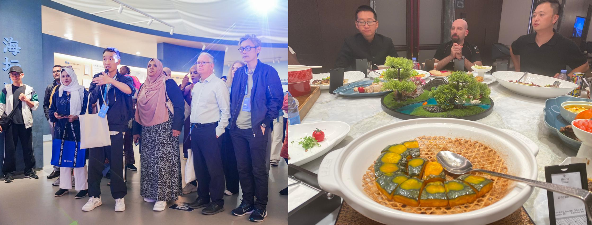{width=80% fig-align="center"}

Looking back, WYSS 2026 was much more than a scientific gathering. It was an opportunity to exchange ideas, learn from researchers across disciplines, build international connections and experience the culture and hospitality of Wenzhou. I returned with new perspectives on the role of AI in science, the importance of responsible research and the value of global collaboration. The summit also reinforced the importance of involving young people in shaping the future of AI and empowering them to contribute to its responsible development. I am grateful to OWSD for this opportunity and to everyone who made this journey so memorable. Most importantly, the summit reminded me that science grows stronger when we share knowledge, cross borders and work together towards a better future.